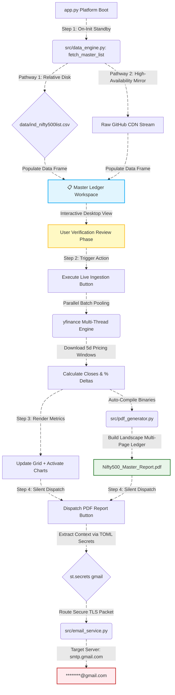

# 📊 Nifty 500 Market Performance Enterprise Workspace

A production-grade Streamlit terminal engineered to map daily market trends across all 500 Nifty constituents. This application follows a strict **Verification-First structural framework**, ensuring you can inspect the base equity index layout on your desktop screen before compiling the ReportLab accounting ledger and initiating downstream email operations via secure SMTP.

---

## 📂 System Architecture Repository Tree

```text
nifty500-market-matrix/
├── .streamlit/
│   └── secrets.toml          # Encrypted enterprise credentials & target email storage
├── data/
│   └── ind_nifty500list.csv  # High-speed local baseline ledger fallback (Auto-generated)
├── src/
│   ├── __init__.py           # Explicit package boundary initialization
│   ├── data_engine.py        # Core processing matrix bypassing firewall blocks (yfinance)
│   ├── email_service.py      # Secure SMTP distribution layer targeting port 587
│   └── pdf_generator.py      # Production ReportLab engine drafting landscape documents
├── app.py                    # Streamlit interface executing port 8501 runtimes
└── README.md                 # System operational manual with structural Mermaid diagrams
```

---

## 🛠️ Architecture & Core Components



---

## 🚀 Local Network Initialization

To spin up the server environment locally on port **`8501`**, execute the following sequence inside your project repository terminal:


### Boot Up the Streamlit Core Server
Run the platform using the explicit network flag to map the interface directly to port `8501`:

```bash
streamlit run app.py --server.port 8501 --server.address localhost
```

Once executed, open your desktop browser and navigate to the live deployment link:
🔗 **`http://localhost:8501`**

---

## ⚡ Operational Guidelines

1. **Phase 1 (Verification Standby):** On application boot, the master list of 500 scrips will instantly load onto the interactive desktop table grid. Use the inline search box to verify components or sectors before running calculations.
2. **Phase 2 (Live Sync):** Click **Execute Live Ingestion** in the sidebar. The system will leverage high-concurrency batch threads to map price deltas, paint color-coded trends (`🟢 Up` / `🔴 Down`), and generate a landscape PDF balance sheet.
3. **Phase 3 (Document Delivery):** Click **Dispatch PDF Report**. The core will match your binary workspace payload against your hidden `secrets.toml` recipients list and route the finished document out without exposing confidential data fields on-screen.
